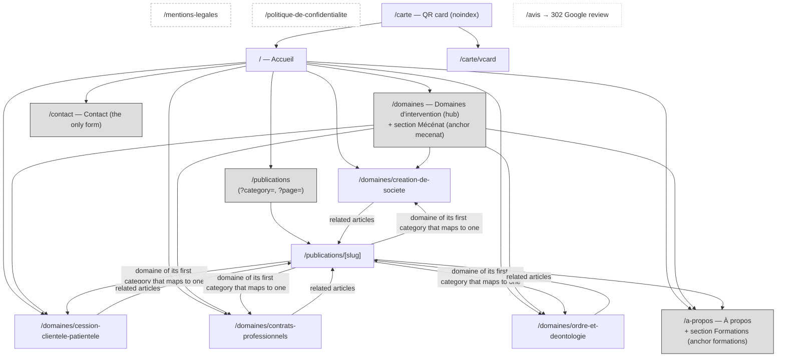

# Information architecture and navigation — decisions (#67)

Owner: `ux`. Inputs: `spec.md` (lead's proposal), #66 `objectives.md` (decided 2026-11-20, cited as
**#66 §n**), `plan-redesign/audit.md` (cited as **A-nn**), the code on this branch. Companion file:
`url-table.md` (every URL, redirect, index and canonical status, for #78).

Scope: structure only. Labels in « » are **working labels**; #68 writes the final words. No visual
design: sizes, colours and type are #69/#71. "Action" = one click or tap.

Contents: 1 Site map · 2 Domaines and professions · 3 À propos and Contact · 4 Navigation ·
5 Review ask · 6 Home · 7 Footer · 8 Page ends and internal linking · 9 Breadcrumbs ·
10 Journeys · 11 "≤ 2 actions" check · 12 CTA origin · 13 From #66 (and `location` enum) ·
14 Changes from the lead's proposal · 15 Open questions for Eva · 16 Follow-ups.

---

## 1. Site map

Grey = a top-level header item (the domaine pages are reached through the « Domaines » panel, so they are not grey). Dashed = footer only. Dotted = print / email only:
`/avis` is never linked from the site (site review links point straight to Google, §5). `/carte` is
reached only by the printed QR code. Every page (except `/carte`, `/carte/vcard`, `/avis` and the root `global-error`, §11) has the
header and footer, so every page links to `/contact`, the hub, the 4 domaine pages (header menu and
footer), `/a-propos` and `/publications`.

Page inventory (final slugs; French, lowercase, hyphenated, no accents, no trailing slash):

| Page | URL | Status | Job |
|---|---|---|---|
| Accueil | `/` | kept | Promise + audience + contact for brand / GBP / word-of-mouth visitors (J1) |
| Domaines d'intervention (hub) | `/domaines` | **new** | Overview of the offer, parent of the domaine pages, home of the Mécénat section |
| Création de sociétés | `/domaines/creation-de-societe` | **new** | Rank on "créer une SEL / SCM / SPFPL Lyon"; convert |
| Clientèle / patientèle | `/domaines/cession-clientele-patientele` | **new** | Rank on "cession de patientèle / clientèle"; covers prêt and apport too |
| Contrats professionnels | `/domaines/contrats-professionnels` | **new** | Rank on contrat de collaboration / remplacement / d'exercice |
| Ordre et déontologie | `/domaines/ordre-et-deontologie` | **new** | Relations with the Ordre, déontologie, Conseils de l'Ordre (contentieux ordinal) |
| À propos | `/a-propos` | **new** (was `/#a-propos`) | Credentials and proof (A-04), author page of the articles, Formations section |
| Contact | `/contact` | **new** (was `/#contact`) | The single form + phone + email + address; target of every contact CTA |
| Publications | `/publications` | kept | Article list, category filter, pagination |
| Article | `/publications/[slug]` | kept | SEO entry (J2) → trust → contact |
| Mentions légales | `/mentions-legales` | kept | Legal |
| Politique de confidentialité | `/politique-de-confidentialite` | kept | Legal |
| QR card | `/carte`, `/carte/vcard` | kept | J4 (printed QR code, noindex) |
| Review short link | `/avis` | **new** | Printable / emailable link, 302 to the Google review page (J3) |

---

## 2. Domaines and professions

Criteria (brief §1): distinct search intent · distinct audience · enough content to avoid a thin
page · priority for the firm (positioning A, #66 §3).

| `SERVICES.items` | Decision | Reason |
|---|---|---|
| Création de sociétés | **Own page** `/domaines/creation-de-societe` | Core of positioning A ("choix de la société, statuts"); strongest search intent (SEL, SCM, SCI, SPFPL + "Lyon", K9); the richest current copy (5 structures) gives #68 a base for "pour qui / situations / FAQ" |
| Clientèle / Patientèle | **Own page** `/domaines/cession-clientele-patientele` | Named in positioning A ("opérations sur leur clientèle ou patientèle"); distinct, high-intent queries ("cession de patientèle avocat"). Slug keeps the searched word *cession*; the page also covers prêt and apport (h1 and copy by #68). Slug confirmed from the lead's proposal |
| Contrats professionnels | **Own page** `/domaines/contrats-professionnels` | Named in positioning A ("contrats"); distinct queries (contrat de collaboration, de remplacement, d'exercice libéral) and a distinct moment (joining / leaving a practice) |
| Contentieux | **Own page** `/domaines/ordre-et-deontologie` (renamed from « Contentieux ») | Positioning A frames one accompaniment: relations with the Ordre, déontologie, and *if needed* the Conseils de l'Ordre. Litigation is the end of that path, not the whole of it, so a `contentieux-ordinal` slug would be false for most of the page and a scope change later costs a 301. "Contentieux ordinal" stays a target query: #68 puts it in the title / h1 / a section, which weigh more than the slug |
| Mécénat | **Section of `/domaines`**, anchor `#mecenat`; no page | Absent from positioning A; different audience (porteurs de projets associatifs, not liberal professionals); one sentence of copy today, so a page would be thin. Own page later only if Eva confirms the activity and supplies the content (§15 Q3) |
| Formations | **Section of `/a-propos`**, anchor `#formations`; listed on `/domaines` as a one-line pointer | Different buyer (organisations, not prospects); absent from positioning A; trainings given are on #66's proof list (§3), so they serve trust on the page that carries proof. The pointer on the hub keeps it findable for an organiser looking at the offer |

**Launch gate (thin-page rule, spec "Constraints").** A domaine page ships only if #68 fills the
#72 template minimum: for whom, what Eva does, how it goes, ≥ 3 typical situations, ≥ 3 FAQ. A page
that misses the gate is **not created** (no URL, no redirect needed): its content stays as a
section of `/domaines` with an anchor (`#creation-de-societe`, etc., same slug as the future page),
and **every** link to that domaine, wherever it sits (header panel, footer, home cards, hub cards,
« Autres domaines », article « En savoir plus »), points to that anchor. Rule for #80: all these
links are built from **one domaine list** (slug, label, `hasPage`); a link is `/domaines/<slug>`
when the page exists and `/domaines#<slug>` when it does not, and no component hand-writes a domaine
URL. Each hub section keeps that id even after its page exists, so an old link to the anchor never
breaks.

**Professions: no per-profession pages at launch.** #66 §1 confirms only health (« patientèle »);
the other professions are to be confirmed by Eva, so there is nothing to fill a page with, and a
page per profession × domaine would be thin. Professions appear instead:
- in the hero audience line (#68 wording);
- as a « Pour qui » block on each domaine page (the professions that domaine serves);
- as a short « Pour qui » paragraph on `/domaines`.

Revisit after launch with K9: if domaine queries naming one profession (e.g. "SEL médecin",
"cession patientèle kiné") show steady impressions for 3 months **and** Eva confirms that
profession and can supply specific content. No URL is reserved now.

---

## 3. À propos and Contact: page or section

**À propos: own page `/a-propos`, plus a teaser on home.**
Reason: proof needs room (credentials, oath year, professions served, memberships, trainings: #66
§3 list, A-04) that a home section cannot hold without pushing the contact block down; articles
need an author page to link to (J2 trust, A-09); Formations lives there (§2). Home keeps a short
teaser (portrait, 2-3 lines, link) with id `a-propos` so old `/#a-propos` links still land on it.
Page content order (for #68/#71, not a design): who Eva is and credentials → approach (the
positioning) → Formations (`#formations`) → her latest publications (link) → contact band.

**Contact: own page `/contact`; the form lives only there. Home ends with a contact band
(CTA + phone + email + address), not the form.** This settles the point #66 §4 left to #67.
Reasons:
- One target for every CTA on every page (header, hero, domaine pages, article end, 404): the
  visitor always lands on the same form, and the CTA label always means the same thing (A-05).
- One form = one set of states to design and test (#74, #83) and one `origin` mechanism (§12),
  instead of a home form and a page form diverging.
- The full form (6-7 fields) is about two mobile screens; removing it from home shortens J1 for
  visitors who call or email, and the hero CTA and the sticky header already reach `/contact` in
  one action.
- `/contact` is a URL Eva can give (email signature, GBP, LinkedIn), unlike `/#contact`.

The home contact band keeps id `contact` so old `/#contact` links (404 page today, possibly
emails) land on the channels, one action from the form.

`/contact` content order (for #74): h1 → the three channels as equals (phone and email first on
mobile, #66 §7) → form → address (link to the map) and access. No booking UI (#66 §4).

---

## 4. Navigation

One header model on every public page except `/carte` (which has no header). No overlay variant,
no scroll-spy, no hero-logo trick (A-18): the header is the same on home and elsewhere, and every
link is a route, never an anchor on the current page. The only fragments are cross-page ones:
the launch-gate fallback `/domaines#<slug>` (§2, used by every domaine link when a page is missing), `/domaines#mecenat` and `/a-propos#formations`;
on `/domaines` a fallback link to its own section counts as the `/domaines` active state (§4.5).

### 4.1 Desktop header (≥ 1024 px)

Left to right:

| # | Slot | Element | Target | Tracking |
|---|---|---|---|---|
| 1 | logo | Logo, accessible name « Eva Biezunski, avocate — accueil » | `/` | — |
| 2 | nav | « Domaines » — disclosure button (see 4.4) | opens panel | — |
| 3 | nav | « À propos » | `/a-propos` | — |
| 4 | nav | « Publications » | `/publications` | — |
| 5 | contact | Phone number as a text link (icon + number) | `tel:` | `tel` / `header` |
| 6 | contact | **Primary CTA button** « Contacter le cabinet » | `/contact` | `contact_cta` / `header` |

- Nav (2-4) sits after the logo; the contact group (5-6) is pushed to the right edge, CTA last
  (rightmost = end of the reading line, the usual place for the primary action).
- 3 nav items + CTA (brief: max 4 + CTA). « Accueil » is dropped (the logo does it, A-02);
  « Votre avis » leaves (§5); « Contact » as a nav item is replaced by the CTA (one contact entry
  in the bar, not two).
- Labels: one word each so they never wrap at 1024 px (A-02 wrap risk). #68 constraint: nav labels
  ≤ 12 characters, CTA ≤ 22 characters.
- Email is **not** in the desktop header (it would make three contact elements in the bar); it is
  in the mobile menu, the contact bands, `/contact` and the footer.

### 4.2 Mobile and tablet header (< 1024 px)

Visible without opening the menu, left to right: **logo** (→ `/`) · **call button** (`tel:`,
icon + short visible label « Appeler » where width allows, accessible name « Appeler le cabinet, » + `CONTACT.phone`
(rendered from the constant, never retyped); tracking `tel` / `header`) · **menu button** (« Menu », `aria-expanded`).

The call button is the one contact action always visible on mobile (#66 §4, A-06): mobile
prospects call first (#66 §7). The form is two actions away (menu → CTA), and one action away
from every page body (hero, contact bands, article end).

### 4.3 Mobile menu (open)

Panel below the header, full width, header stays visible (the menu button becomes « Fermer »).
Content top to bottom:

1. « Domaines » — disclosure, **collapsed by default**, expands in place to: the 4 domaine pages,
   then « Tous les domaines » (→ `/domaines`).
2. « À propos » (→ `/a-propos`)
3. « Publications » (→ `/publications`)
4. separator
5. **CTA button** « Contacter le cabinet » (→ `/contact`; `contact_cta` / `menu`)
6. Phone link (`tel` / `menu`)
7. Email link (`mailto` / `menu`)

Rules: with Domaines collapsed, items 1-7 fit a 390 × 664 viewport without scrolling (so the CTA
is never below the fold of the menu); nothing else in the menu (no legal, no review, no LinkedIn:
footer). The current menu has 6 text links and no action (A-06): this one ends on the three
contact channels.

Behaviour (one line each):
- **Touch**: tap « Menu » opens; tap a link navigates and closes; tap « Fermer » or outside closes.
- **Keyboard**: the menu button is a `button` with `aria-expanded` / `aria-controls`; on open,
  focus moves to the first item; Tab stays in header + panel while open; Esc closes and returns
  focus to the button.
- Page scroll is locked while open; the panel closes on route change.

### 4.4 « Domaines »: disclosure, not link + menu

Decision: on desktop « Domaines » is a **button** that opens a small panel (disclosure navigation
pattern), not a link to `/domaines` with a hover menu. Panel content: the 4 domaine pages (label
+ no description, #71 may add one line each), then « Tous les domaines »
(→ `/domaines`, which also holds Mécénat; same label in the mobile menu and the footer).

Reason: a control that is both a link and a menu trigger is ambiguous on touch (does the tap
navigate or open?) and needs two targets; hover-open menus open by accident and fail on touch. The
hub stays one action away inside the panel.
- **Touch / mouse**: click or tap toggles; clicking outside closes. No open-on-hover.
- **Keyboard**: Enter / Space toggles (`aria-expanded`); Tab moves through the panel links; Esc
  closes and returns focus to the button; focus leaving the button and the panel closes it (Shift+Tab from the first panel link back to the button does not).
- Works without JS: the panel can be a native `
` or the hub link is the fallback
  (#80 picks).

### 4.5 Active state

Route-aware, computed from the path, the same on desktop and in the mobile menu:

| Current path | Marked item | Attribute |
|---|---|---|
| `/` | none (the logo is not marked) | — |
| `/domaines` | « Domaines » button visually active; « Tous les domaines » link in the panel | panel link: `aria-current="page"` |
| `/domaines/<slug>` | « Domaines » button visually active; that domaine's link in the panel | panel link: `aria-current="page"` |
| `/a-propos` | « À propos » | `aria-current="page"` |
| `/publications` (any query) | « Publications » | `aria-current="page"` |
| `/publications/<slug>` | « Publications » | `aria-current="true"` (section, not the page itself) |
| `/contact` | header CTA shown as current (no hover affordance) | `aria-current="page"` |
| legal, 404, error | none | — |

When a domaine page missed the launch gate (§2), its panel link points to `/domaines#<slug>`, the same path as « Tous les domaines »: on `/domaines` only « Tous les domaines » carries `aria-current="page"`; the anchor links carry none (one `aria-current="page"` per list).

`aria-current` is a global ARIA attribute, so the « Domaines » button also carries
`aria-current="true"` (current section) on `/domaines` and `/domaines/<slug>`, with the visual
active state; the panel link carries `aria-current="page"`. In the mobile menu, on a domaine page the Domaines disclosure still opens
collapsed (consistency, menu fits without scroll), the button shows the visual active state.

### 4.6 Sticky

**Sticky on every viewport, always visible (no hide-on-scroll).** Reason: the call button (mobile)
and the CTA + phone (desktop) are the "one contact action in the header on every page" of #66 §4;
J2 readers are deep in a long article when they decide, and a header that hides on scroll-down
makes the action disappear exactly then. Mobile cost: one compact bar (#71 keeps it to a single
row, about 56-64 px, ≈ 9 % of a 664 px viewport). Anchored sections need a scroll offset equal to
the header height (A-26: derive it, do not hard-code).

---

## 5. Review ask

The review ask (J3, rank 3) leaves the main nav and the home page (A-02, #66 §1-2). It appears in:

| Place | Form | `location` |
|---|---|---|
| Footer, « Le cabinet » group | text link « Laisser un avis » (the group carries id `avis`) | `footer` |
| End of article, last line of the author card | text link « Client du cabinet ? Laisser un avis » | `article` |
| `/carte` | secondary link under the contact links | `carte` |
| Print / email | `/avis` short URL | — (server count, §16) |

Never a button, never above or beside a contact CTA (#66 §7, #71: secondary paths never compete
with the CTA). It opens Google in a new tab; the accessible name says so (A-15).

**`/avis`: yes.** A 302 (temporary: the target is external and Eva may replace the link) from
`biezunski-avocat.fr/avis` to the Google review URL. Reason: Eva can print it or say it ("…-avocat.fr
slash avis") on invoices, emails and the card, unlike a `maps.app.goo.gl` code; the target can
change without reprinting; and the server can count hits (K8 gets a direct count for printed
asks). Site links point straight to the Google URL (one hop less). Not indexed, not in the sitemap.

The home « Votre avis » band is removed, so `home_review` leaves the `location` enum (§13).

---

## 6. Home

Order, with the one job of each section and the question it answers for a prospect:

| # | Section (working title) | id | Job | Holds |
|---|---|---|---|---|
| 1 | Hero | `accueil` | Say who it is for and what Eva does, give the action (#66 §3, §7) | Promise (positioning A), audience line, CTA « Contacter le cabinet » (`hero`), phone (`tel` / `hero`). On mobile the promise, CTA and phone are above the fold |
| 2 | Domaines | `domaines-intervention` | "Does she handle my case?" — route to the right domaine page | The 4 core domaines, each linking to its page (A-03, A-08: core only, not 6 equal cards); one line « Également : mécénat, formations » → `/domaines#mecenat`, `/a-propos#formations`; link « Tous les domaines » → `/domaines` |
| 3 | À propos / proof | `a-propos` | "Can I trust her?" | Portrait, 2-3 lines, credentials (#68 proof layer), testimonials only when Eva has consented ones; link → `/a-propos` |
| 4 | Publications teaser | `publications` | Credibility: show expertise in action | 3 latest articles + « Voir toutes les publications » → `/publications` (shown from 1 article; hidden if 0 or the API fails) |
| 5 | Comment ça se passe | `premier-contact` | "What happens if I write?" — lower the cost of the first step | First exchange, what to prepare, response delay, fee principle (#66 §3 proof list, A-07). **Conditional**: dropped if #68 cannot get the facts from Eva |
| 6 | Contact band | `contact` | Act | CTA → `/contact` (`contact_section`), phone, email, address. No form (§3) |
| — | Footer | — | Coordinates and secondary paths | §7 |

**Role of publications: credibility, not conversion.** On home they prove expertise to a visitor
who already came for Eva (J1), so they sit with the proof (after À propos) and **before** the
contact band (A-32: today they come after Contact, so they never lead into it). Conversion from
articles happens on the article page itself (J2, §8).

Changes from the lead's order: « Comment ça se passe » moves **after** the publications teaser,
just before the contact band. It answers the last question before acting, so it should touch the
contact band; publications are proof and sit with the proof. Ids `accueil`, `a-propos`,
`domaines-intervention`, `contact` are kept from the current home so old hash links still land
(`url-table.md`).

No extra CTA band mid-page: the sticky header carries the action at every scroll position.

---

## 7. Footer

Same footer on every page with a header (no variants, A-18). Three link blocks on desktop
(columns) plus a full-width legal row, stacked in the same order on mobile:

| Block | Content | Tracking |
|---|---|---|
| Identity | Logo · « Avocate au Barreau de Lyon » · address (link to the map) · phone · email · LinkedIn (new tab, said in the name) | `tel` / `mailto` / `footer` |
| Domaines | The 4 domaine pages · « Tous les domaines » (`/domaines`) | — |
| Le cabinet | À propos · Publications · Contact (`/contact`, `contact_cta` / `footer`) · « Laisser un avis » (Google, new tab, `review` / `footer`; the « Le cabinet » group carries id `avis`, §5) | as listed |
| Legal row | © line · Mentions légales · Politique de confidentialité · site credit | — |

- Block titles are **not headings** (A-31): plain text styled as a label; each link group is a
  list inside one `<nav aria-label="Pied de page">`; the identity block is an `<address>`.
- Not repeated from the header: no CTA button (the contact band or article end sits just above),
  no « Accueil » (the logo links home).
- Mécénat and Formations are not listed (secondary; reachable via the hub and À propos).

---

## 8. Page ends and internal linking

Every content page ends with an exit toward contact; no dead end (A-09).

**End of each page type**

| Page | Ends with (top to bottom, before the footer) |
|---|---|
| Home | Contact band (§6) |
| `/domaines` | Domaine list (4 cards → pages, or anchors on this page for a page that missed the gate) · Mécénat section (`#mecenat`) · « Pour qui » · pointer to Formations · contact band (`domaine`) |
| Domaine page | Content (#72) · related publications · « Autres domaines » (the 3 others, from the domaine list, §2) · contact band (`domaine`) |
| Article | **Author card** (photo, name, credential line, link → `/a-propos`, review text link §5) → **contact block** (CTA + phone, contextual line by #68, `article`) → **related articles** (2-3) → room for the `article_read_end` sentinel at the end of the body (#66 §6, #73 places it) |
| `/publications` | List · pagination · contact band (`publications`) |
| `/a-propos` | Formations · publications link · contact band (`about`) |
| `/contact` | The form is the page; no band |
| Legal | Header and footer only |
| 404 | Message · links: Accueil, Domaines (`/domaines`), Publications, Contact (`/contact`, `not_found`) · phone (`tel` / `not_found`) |
| `/carte` | Save contact (vCard) · call · email · address · « Visiter le site » (`/`) · review link (§5) |

**Linking rules**

1. **Home → domaines**: each core domaine card links to its page (or to its `/domaines#<slug>`
   anchor if the page missed the launch gate, §2: links to a domaine always come from the one domaine
   list); the hub is linked once.
2. **Domaine ↔ publications via categories.** Each domaine page maps to one or more publication
   categories (`Category.slug`). The domaine page shows the 3 latest articles of its categories and
   « Voir les publications sur ce thème » → `/publications?category=<slug>` (hidden when there is
   no article). An article links back to one domaine: the first of its categories (in the categories' display order; `Article.categories` is many-to-many) that maps to a domaine; one line « En
   savoir plus : [domaine] » (built from the domaine list, §2) after the body (inside the contact block or just before it, #73
   decides). The mapping is data, not hand-written links (#76/#80: a `domaine` field on
   `Category` or a constant; see §16). Categories that map to no domaine (e.g. news) simply have no
   domaine link.
3. **Article → author**: the byline and the author card link to `/a-propos`.
4. **Article → contact**: the article-end contact block, every article (#66 §4).
5. **Article → articles**: 2-3 related articles (same category first, else latest); the
   breadcrumb replaces the « Retour aux publications » link (§9). Preserving the list's filter
   state (A-10) is #73.
6. **Domaine → domaine**: « Autres domaines » lists the other 3.
7. **À propos → publications**: link to her articles (the list; author filter not needed: single
   author).
8. **Every CTA → `/contact`**. No CTA points to an anchor or to any page other than `/contact`.
9. **404 → hub and contact** (spec), plus home and publications.
10. In-body links written by Eva (article Markdown) to a domaine page are encouraged (#76 editor
    tip), not required by the IA.

---

## 9. Breadcrumbs

Shown on **level-2 pages only**: domaine pages and articles. Not on home, level-1 pages
(`/domaines`, `/a-propos`, `/contact`, `/publications`, legal) where « Accueil › X » adds nothing.

| Page | Trail |
|---|---|
| Domaine page | « Accueil » (`/`) › « Domaines » (`/domaines`) › [domaine name, not a link, `aria-current="page"`] |
| Article | « Accueil » › « Publications » (`/publications`) › [article title, not a link, `aria-current="page"`] |

- Position: top of the content, below the header, above the h1. In a `<nav aria-label="Fil
  d'Ariane">` with an ordered list.
- On mobile the last crumb may be truncated (#72/#73); the links never are.
- On articles the breadcrumb replaces « ← Retour aux publications » (same target, one element).
- The same trails feed `BreadcrumbList` JSON-LD on these pages only (#78). Level-1 pages show no
  breadcrumb, so they get no `BreadcrumbList` (structured data must match visible content).

---

## 10. Journeys in the new structure

**J1 (rank 1) home → understand → contact.** Lands on `/` (brand search, GBP, word of mouth) →
hero: promise + audience, CTA and phone visible (mobile: above the fold) → if unsure: Domaines
section → domaine page (« Pour qui », situations) or proof (À propos teaser, publications) →
« Comment ça se passe » → contact: call (phone in hero, header or band: 1 action) or CTA →
`/contact` (1 action) → form. At every scroll position the sticky header offers the same action.
Today: CTA promises a booking and scrolls past 4 sections, phone only at the bottom (A-05, A-06).

**J2 (rank 1) publication from search → trust → contact.** Lands on `/publications/<slug>` →
breadcrumb shows where it is → reads; sticky header keeps call / CTA one action away → end of body
→ author card (credentials, → `/a-propos`) → contact block: CTA → `/contact` (origin = the article
path, §12) or phone → else related articles or « En savoir plus : [domaine] » → domaine page →
its contact band. Today: dead end after the body (A-09).

**J4 (rank 2) QR card → save contact / visit.** Scans the printed QR → `/carte` (same URL) → save
vCard (`/carte/vcard`), or call / email / map on **every platform** (today iOS only, A-11), or
« Visiter le site » → `/` (J1). Review link at the bottom for clients. Desktop or unknown UA gets
the same card instead of a silent redirect to `/` (A-11; `url-table.md`).

**J3 (rank 3) client → leave a review.** Eva sends `/avis` or the Google link → Google. On the
site: footer « Laisser un avis » (every page), the author card at the end of articles, `/carte`.
Not in the header, not on home (A-02).

**J5 (rank 4) Eva → write → publish.** Unchanged entry: the secret `/${BACKOFFICE_PATH}/*` prefix
that `proxy.ts` rewrites to `/backoffice/*` (direct `/backoffice` hits get the 404; not linked from
the public site, `X-Robots-Tag: noindex, nofollow`). The IA asks one thing of it: categories aligned with the domaines so articles link
to domaine pages (§8 rule 2, #76).

---

## 11. "≤ 2 actions to a contact request" (#66 §1)

Counted as: actions to **start** a request on a channel — the call starts (`tel:`), the mail app
opens (`mailto:`), or the form is on screen. Typing the message is not counted.

| Page type | Desktop | Mobile |
|---|---|---|
| Home | header phone (1) · header CTA → form (1) · hero CTA (1) | header call (1) · hero CTA → form (1) · menu → CTA (2) |
| `/domaines`, domaine page | header phone / CTA (1) · contact band (1) | header call (1) · menu → CTA / email (2) · band (1, after scroll) |
| Article | header phone / CTA (1) · article-end block (1) | header call (1) · menu → CTA (2) · article-end block (1) |
| `/publications` | header (1) | header call (1) · menu → CTA (2) |
| `/a-propos` | header (1) · band (1) | header call (1) · menu → CTA (2) |
| `/contact` | form on the page (0) · phone / email (1) | channels first (1) · form (0, scroll) |
| Legal | header (1) | header call (1) · menu → CTA (2) |
| 404 | header (1) · page links Contact / phone (1) | header call (1) · page link (1) |
| Error page (`error.tsx`, with header) | header (1) | header call (1) |
| `/carte` (no header) | call / email links on the card (1) — every platform | same (1) |
| `global-error` (no header, root crash) | **fails today**: no phone shown. Follow-up: show phone and email as plain links, **without `data-track`** (the click listener is mounted in the root layout, which `global-error` replaces), so these clicks carry no `location` (0-1) | same |

All page types pass at ≤ 2 once the header of §4 ships, `/carte` shows the links on every platform,
and `global-error` gets the phone (#80, §16).

---

## 12. How the CTA `origin` reaches the form

Need (#66 §6): `/api/contact` records `origin` = path of the page where the contact CTA was
clicked, else `direct`, without creating indexable URLs and **without storing anything on the
device** (#66's "no banner" analysis rests on "nothing stored or read on the device").

**Decision: no query parameter and no browser storage. The click listener keeps the path in
in-memory client state; the form reads it, with the same-origin referrer as a fallback only on a
first full load.**

1. The single delegated listener (specified by #66 §6, built by #80; it does not exist yet) that
   sends `link_click` also sets, on a `data-track="contact_cta"` click, the in-memory origin =
   **the origin the page declares**. The state is a module-level variable (or a context in the root
   layout) that survives Next.js soft navigation and is gone on a reload or in a new tab. One rule,
   set once in the shared page layout: by default a page declares its pathname (path only: no
   query, no hash); the 404 declares `/404` (its pathname is the unknown URL); `/contact` declares
   none, so a click on its own header CTA never overwrites the real origin. The listener sets
   nothing when the page declares none.
2. The `/contact` form reads that value when it submits. If it is empty **and `/contact` was the
   tab's first full page load**, it uses `document.referrer` if same-origin, reduced to its
   pathname. Otherwise `direct`. (After a soft navigation `document.referrer` still holds the
   referrer of the first full load, so it is never used then: full load of `/a-propos` from `/`,
   then an untracked soft link to `/contact`, must give `direct`, not `/`.)
3. The value is cleared after a successful send and overwritten by the next CTA click.
4. The server keeps it only if it matches a known public route pattern (`/`, `/domaines…`,
   `/a-propos`, `/publications…`, legal, `/404`); anything else is stored as `direct`.

**Nothing is written to cookies or Web Storage (`sessionStorage`, `localStorage`), so #66's consent
analysis stands.**

Why not the alternatives:
- `/contact?origin=/publications/x`: works without JS and across tabs, but every CTA creates a new
  URL variant that is shared, bookmarked and crawled; it needs `noindex` or a canonical on each,
  shows a path in the address bar, and leaks into analytics as separate pages. The spec asks to
  avoid indexable URLs; the cleanest way is not to create them.
- `sessionStorage`: survives reloads and is shared with same-tab navigation, but it is a write to
  the device, which would break #66's "nothing stored or read" premise.
- `document.referrer` alone: Next.js client-side navigation does not update `document.referrer`
  (it keeps the referrer of the first full page load), so after any in-site soft navigation it
  points to the wrong page or to Google. It is used only as the fallback when `/contact` is the
  tab's first full load (e.g. a CTA opened in a new tab, where the in-memory state is empty).

Constraints for #80 / #83: the form needs JS anyway (BotID, client submit), so no loss. Keep the
browser default `Referrer-Policy` (`strict-origin-when-cross-origin`) or `same-origin`; never
`no-referrer`. Name the body field `origin` but do not confuse it with the HTTP `Origin` header
that `lib/contact.ts` already checks for same-site posts. Known inaccuracy: in-memory state is lost
on a reload, so a visitor who clicks a CTA and then reloads `/contact` is recorded as `direct`, or as the same-site page of the tab's first full load if there was one (a stale referrer);
and one who clicks a CTA, goes back, browses, then reaches `/contact` by an untracked soft link
keeps the old origin (cleared only by a send or the next CTA click). Both are acceptable for a
count.

---

## 13. From #66

| Decision here | Rests on |
|---|---|
| Nav items and home order serve prospects only; review, `/carte` and back-office paths live in the footer, article end, `/carte`, `/avis` | §1 audiences ranking and rule; §2 J3 rank 3 |
| Contact action in the header on every page: desktop phone + CTA, mobile call button; sticky, never hidden | §1 success "≤ 2 actions"; §4 "same contact action in the header on every page"; §7 hand-off |
| Phone `tel:` visible on mobile without opening the menu; tel/mail first on `/contact` mobile | §4; §7 (#74 line) |
| CTA in the "Contacter le cabinet" family, always → `/contact`; no booking page | §4 |
| `/contact` exists and holds the only form; home has a contact band | §4 ("on the page or `/contact`, per #67"); §7 "whether `/contact` exists" |
| Every article ends with author card + contact block (+ origin) + related; room for `article_read_end` | §4; §6 event plan; §7 (#73 line); §2 J2 rank 1 |
| 4 core domaine pages = the 4 subjects of positioning A; Mécénat and Formations secondary | §3 positioning A |
| « Contentieux » becomes « Ordre et déontologie » | §3 positioning A wording |
| No per-profession pages; « Pour qui » blocks; revisit with K9 | §1 professions (health only confirmed); §5 K9 |
| Formations on À propos as proof | §3 proof list (trainings given) |
| Review out of the main nav and off home; `/avis` short URL | §1 rule; §2 J3; A-02 |
| Hero: promise + audience + CTA + phone above the fold on mobile | §3; §7 (#71 line) |
| Origin via in-memory client state + first-load referrer fallback; nothing stored on the device; path only, never query string | §6 (event values: paths, never query strings) |
| `/carte` keeps its URL and shows call/email on every platform; review link added | §2 J4 rank 2; §1 audience 3; K6, K7 |
| Domaine pages must rank on domaine queries | §5 K9 (domaine vs brand split) |

**Final `location` enum** (replaces the list in #66 §6; #80 implements it once):

| Value | Slot | Status |
|---|---|---|
| `header` | Header: desktop phone + CTA; mobile call button | kept |
| `menu` | Mobile menu: CTA, phone, email | **added** |
| `hero` | Home hero: CTA, phone | kept |
| `contact_section` | Home contact band (`#contact`): CTA, phone, email | kept (now a band, no form) |
| `contact_page` | `/contact`: phone, email links on the page | kept |
| `domaine` | Contact band on `/domaines` and on each domaine page (form requests from the hub and the pages are told apart by `origin`; `link_click` carries no path, so tel / mailto clicks from these bands are counted together) | **added** |
| `about` | Contact band on `/a-propos` | **added** |
| `publications` | Contact band on `/publications` | **added** |
| `article` | Article end: contact block (CTA, phone) and author-card review link | kept |
| `footer` | Footer: phone, email, Contact link, review link | kept |
| `carte` | `/carte`: phone, email, review link (vCard is `kind=vcard` here) | kept |
| `legal` | Phone / email links inside the legal pages' text | kept |
| `not_found` | 404: Contact link, phone | kept |
| `home_review` | — | **removed** (the home « Votre avis » band goes) |

Consistency rule: a value names a **slot type**, not a page. A new page type that adds a contact
band adds a value here first.

---

## 14. Changes from the lead's proposal

| Point | Lead's proposal | Decision | Reason |
|---|---|---|---|
| Domaines in the header | link to `/domaines` + disclosure menu | **Disclosure button only**; hub is the last link in the panel | One control = one behaviour; avoids tap ambiguity and hover-open (§4.4) |
| Ordre slug | `ordre-et-deontologie` (or `contentieux-ordinal`) | `ordre-et-deontologie` confirmed; "contentieux ordinal" goes in title/h1 | Slug must stay true to the full scope of positioning A (§2) |
| Formations | section of `/a-propos` or `/domaines` | `/a-propos#formations` + one-line pointer on the hub | Proof for prospects, offer for organisations (§2) |
| Form on home | ux to decide | **Form only on `/contact`**; home has a contact band | One target, one form, shorter home (§3) |
| Home order | … Proof → How it works → Publications → Contact | … Proof → **Publications → How it works** → Contact | "How it works" is the last question before acting (§6) |
| Domaine pages | 4 pages | 4 pages **behind a content gate** (fallback: hub section with the same slug as anchor) | Thin-page risk (§2) |
| Footer | 4 columns incl. « Clients » (avis, LinkedIn) | 3 link blocks: Identity (incl. LinkedIn), Domaines, Le cabinet (incl. avis) + legal row | A one-link « Clients » column is thin; LinkedIn is for everyone (§7) |
| Mobile menu | items + CTA + email | items, then CTA + **phone** + email at the bottom; Domaines collapsed by default | The menu ends on actions and fits one screen (§4.3) |
| Sticky | ux to decide | Sticky everywhere, never hidden on scroll | Contact action must stay visible in long articles (§4.6) |
| Breadcrumbs | domaine pages and articles | Same, level-2 only; replaces the article back link | §9 |
| `/avis` | optional | **Yes**, 302 | §5 |
| Hash anchors | kept or client-side | **Kept as ids**, no client-side redirect | Simpler, works without JS (`url-table.md`) |
| `origin` | parameter, sessionStorage or referrer | in-memory client state (no Web Storage) + same-origin referrer on a first full load | §12 |
| `location` enum | adds `domaine`, `menu`, drops `home_review` | also adds `about`, `publications` | Every page type ends with a contact band (§8, §13) |
| `/carte` | unchanged | URL unchanged; contact links on every platform, no desktop redirect, review link | A-11, J4 rank 2 (§10) |
| `?page=` canonical | (not covered) | self-canonical, not `/publications` | `url-table.md` (for #78) |

Everything else in the lead's proposal is confirmed: the site map and slugs, `/a-propos`,
`/contact`, publications and legal URLs unchanged, no profession pages, review out of the nav, one
nav model, route-aware active state, publications as credibility before contact.

---

## 15. Open questions for Eva

| # | Question | Blocks |
|---|---|---|
| Q1 | For each of the 4 domaines: can you supply for whom, what you do, how it goes, 3 typical situations, 3 FAQ? Which domaine matters most to you (it can lead the home list)? | Launch gate §2; #68, #72 |
| Q2 | Is « Ordre et déontologie » the right scope for one page: relations with the Ordre, déontologie questions, and representation before the Conseils de l'Ordre? | §2; #68 |
| Q3 | Mécénat: do you still take this work, for whom, and is there enough to say for a section (and later a page)? | §2 |
| Q4 | Formations: which trainings have you given (organisers, audiences, topics)? Do you want organisers to request trainings (an offer) or only show them (proof)? | §2, À propos |
| Q5 | Which professions do you actually serve (santé? which ones? droit? chiffre?) — also asked by #66 | « Pour qui » blocks; profession pages later |
| Q6 | Have you shared links to `biezunski-avocat.fr/#contact` or other `#…` anchors (emails, signature, LinkedIn, GBP, printed material)? Which URL does your Google Business Profile "website" field use? Did a site exist at this domain before the current one (old page addresses)? | `url-table.md`, #78 |
| Q7 | First contact: format of the first exchange, usual response delay, how fees are discussed — can the site say it? | Home « Comment ça se passe » (conditional, §6) |
| Q8 | OK to print and give out `biezunski-avocat.fr/avis`? Can you send the direct "write a review" link from your Google profile (the current `maps.app.goo.gl` link opens the map, not the review form, J3)? | §5 |

---

## 16. Follow-ups

| Issue | Takes from this file |
|---|---|
| ui (this feature) | Wireframes: sitemap §1; header desktop §4.1; header mobile §4.2; menu open with Domaines expanded §4.3; active state on « Publications » (§4.5); footer §7; home stack §6; optional journeys §10 |
| #68 Copy | Labels: nav ≤ 12 chars, CTA ≤ 22 chars (§4.1); domaine content to the launch gate (§2); « Pour qui »; « Comment ça se passe »; article-end contextual line; Eva's answers Q1-Q8 |
| #71 Home | Section order and jobs (§6); hero above the fold on mobile; compact sticky header (§4.6) |
| #72 Domaine template | Breadcrumb, « Pour qui », situations, FAQ, related publications (§8 rule 2), « Autres domaines », contact band `domaine`; same template renders the hub sections |
| #73 Publications | Article end order (§8); breadcrumb replaces the back link (§9); « En savoir plus : [domaine] »; list contact band; preserve filter state (A-10) |
| #74 Contact | `/contact` page order (§3); channels as equals; no booking; `CONTACT.subjectOptions` follows the domaines (« Contentieux » → « Ordre et déontologie », with #68's final labels) |
| #76 Back-office | Primary categories aligned with the 4 domaines; mapping domaine ↔ category (a field on `Category` or a constant, decided with #80) |
| #78 SEO | `url-table.md`: canonicals, `?page=` self-canonical, `?category=` canonical, robots (`/carte` disallow vs noindex, A-21), sitemap `lastModified`, `BreadcrumbList` (§9), legacy URLs from Search Console once it exists (K9) |
| #80 Implementation | One header/footer (drop variants, `useScrollSpy`, `NAV_LINKS` anchors); disclosure + menu behaviour (§4); active state (§4.5); `/avis` route (302) and a server count of its hits (event `avis`, no property — add to #66 §6 event list); `/carte` contact links on all platforms + no UA redirect + review link; `global-error` shows phone and email (§11); final `location` enum (§13); `origin` mechanism (§12, in-memory, no Web Storage); one domaine list (slug, label, `hasPage`) behind every domaine link (§2); keep `/images/icons/*` paths (hot-linked by Eva's email signature) |
| #83 Contact implementation | Read and validate `origin` (§12) |
